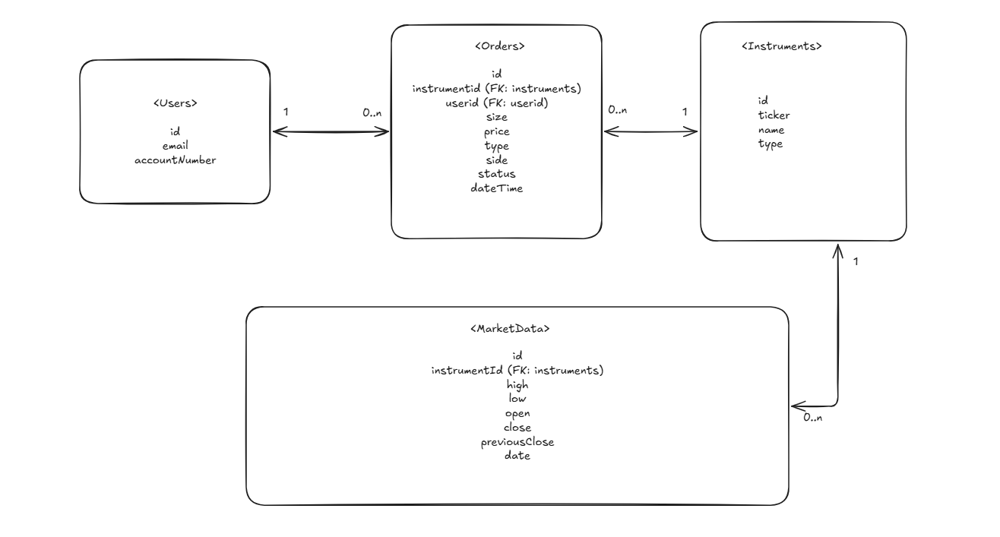

# Cocos Challenge!

Hola a todos, soy Ivan!
Voy a estar haciendo un poco de journaling para evidenciar mi criterio técnico. Este journal está escrito por un humano, para humanos, y tiene como principal propósito comunicar mi intención técnica y servirme a mí como herramienta de análisis, comprensión y diseño.
Cualquier plan o decisión que tome en el journal no es final. Es solo la comunicación de mi intención y razonamiento en ese punto del proyecto.
Voy a avanzar el proyecto siguiendo el principio de que lo importante es tener un plan, no seguirlo a rajatabla. A medida que vaya iterando sobre el proyecto, pueden hacerse obvias divergencias que en un principio no lo eran, y mi intención es bienvenirlas así vayan apareciendo.

Aclaro que en el desarrollo del proyecto pienso utilizar inteligencia artificial con el uso de Spec-Driven Development, a modo de que cada paso de planeamiento, diseño y desarrollo esté debidamente consensuado y documentado. Pero algo que no hace bien la inteligencia artificial es demostrar intención humana, que al final del día es lo que estará siendo evaluado con este ejercicio.

# Enunciado y primeras decisiones

Bueno, como en todo proyecto, las primeras decisiones se toman sin que haya todavía ni una sola línea de código. Voy a comenzar con un relevamiento de las cosas que sé sobre Cocos.

## Mail en el cual se envió el challenge

La primera limitación técnica fue impuesta en el mail en el que recibí el challenge.

> "Por más de que aparezca que realices el challenge con Node.js, en este caso te pedimos que lo realices con Java."

Así que vamos con Java. Voy con Java 21 por el simple hecho de que es la última versión de Java con la que ya venía trabajando y con la que me siento cómodo. Podríamos ir con Java 25, pero no quiero depender de features que no voy a usar.

## JD y lo que sé sobre Cocos

Después, como supuesto tomaré que esta es una API que se construirá sobre el ambiente de trabajo de Cocos. Yo sé que Cocos es una fintech, un lugar donde se maneja y se mueve plata. Esto ya me da pauta de que la seguridad, integridad y trazabilidad de datos va a ser un norte que voy a tener que tener en mente a la hora de tomar decisiones técnicas.

Después, analizando la JD puedo obtener más información sobre requerimientos técnicos que hay que cumplir:

> "Diseñar, desarrollar y mantener soluciones de software robustas y escalables."

Así que a seguridad, integridad y trazabilidad, agregaremos y tendremos en cuenta a la hora de desarrollar: escalabilidad, tolerancia a fallos, observabilidad. En conjunto esos serán los nortes que seguiré a la hora de tomar decisiones.

Nota mental hasta acá: SLA/percentiles todavía no decididos. Según los requerimientos, no hace falta implementar auth.

Dicen en la JD: "Manejo de bases de datos SQL y NoSQL, especialmente Redis, MongoDB y ClickHouse."

Lo voy a tener en mente por si hace falta alguna para ajustar a la solución, como Redis para cache/idempotencia o Mongo para algún tipo de dato no transaccional o auditoría. ClickHouse seguro que no vale la pena meter por la escala del proyectito, pero vamos a ir para adelante teniendo "YAGNI" bien presente y no meter ninguna base no relacional si sabemos que no hace falta.

No mucho más que relevar y/o aprovechar de la JD, que es lo que sé sobre Cocos, vamos al enunciado.

## Enunciado

Le pego una leída completa. Aprovecho que también ya tengo la base de datos cargada con ciertos datos para pegarle un ojo a las tablas y después vamos punto por punto.

Notas:
- Mercado de órdenes. 2 GET y un POST.
- Va a haber que crear una colección de Postman para probar bien la API.
- NO hace falta simular el mercado. Esta afirmación es bastante subjetiva, voy a operar entendiendo que esto quiere decir que no hace falta implementar un motor de matching entre las órdenes LIMIT. Van a quedar siempre en NEW hasta que sean canceladas.
- La base de datos se puede modificar. Voy a tomar la base de datos que se me dio como una suerte de env de "staging/UAT/preprod", así que me copio el esquema y los datos para trabajar localmente. Cuando termine el ejercicio hacemos las migraciones con Flyway.
- Las tablas y columnas, todas en inglés. Este documento de intención es el único documento en español.

## Modelado de datos

Primero un modelito entidad-relación que armé en Excalidraw para entender cómo se relacionan los datos:



Voy a listar las distintas tablas y hacer un pequeño resumen de qué representan y para qué son los datos.

### USERS

El usuario tiene id, email y accountNumber. Es la entidad más sencilla. Tiene account id, pero no tiene cuenta modelada (por ahora, no nos adelantemos, acá simplemente estamos entendiendo lo que ya tenemos). Por ahora lo que me hace ruido es que tenga un único account id acá: te limita a futuro si un usuario quiere abrir más cuentas.

### INSTRUMENTS

Representación de los instrumentos financieros. Inmutable.

- **ticker**: es la abreviatura del mercado para el instrumento.
- **name**: es el nombre.
- **type**: MONEDA o ACCIONES.

### MARKETDATA

Representación (por ahora entiendo que inmutable) de cómo se cerró la valoración de distintos tipos de instrumentos en un día dado.

- **instrumentId**: qué instrumento.
- **date**: para qué día vale la valoración.
- **open**: precio de la primera operación.
- **high**: precio máximo que tocó en el día.
- **low**: precio mínimo que tocó en el día.
- **close**: precio de la última operación.
- **previousClose**: precio de la rueda anterior.

### ORDERS

Acá está donde parecería estar la dificultad principal del modelado; parecería que funciona como 2 entidades distintas:

Libro de órdenes, ledger efectivo de la cuenta.

- **instrumentId**: para qué instrumento es esa orden. Si es type='MONEDA', es que es plata.
- **userId**: a quién pertenece.
- **size**: cantidad de acciones (para instrumentos tipo acciones); es la cantidad monetaria para cash.
- **type**: MARKET o LIMIT. Cómo se ejecuta.
- **price**: cuánto paga. En un LIMIT es hasta cuánto paga el usuario por este instrumento. En un MARKET, es cuánto pagó por el instrumento, que recordemos que era su último close.
- **side**: BUY, SELL (para instrumentos tipo acciones), CASH_IN, CASH_OUT (para cash: plata que entra o sale).
- **datetime**: cuándo se mandó (¿falta timezone?).
- **status**: NEW, FILLED, REJECTED, CANCELLED. Estado.

A ver... MARKET y LIMIT tienen dos tipos de estados distintos:

```text
MARKET -> FILLED porque se ejecuta al instante al close. Nunca pasa por NEW.
       -> REJECTED (si es que el usuario no tiene fondos. Validar que tenga el cash, y en venta validar tenencia insuficiente).

LIMIT  -> NEW -> el usuario la cancela -> CANCELLED
       -> REJECTED (si es que el usuario no tiene fondos. Validar que tenga el cash, y en venta validar tenencia insuficiente).
```

En el modelado de nuestro ejercicio, una LIMIT nunca va a pasar a FILLED porque no simulamos el matching engine. Pero habría que modelar considerando que es algo que eventualmente se va a hacer, como un próximo segundo paso.

Además, una LIMIT en NEW reserva fondos y se descuenta de los disponibles. El enunciado no lo explicita, pero sí obliga a rechazar la orden cuyo monto supere lo disponible, sin distinguir entre MARKET y LIMIT. Y ahí está el problema: una LIMIT no se ejecuta, queda esperando, así que el saldo no se mueve. Sin reservar fondos, con 1.000$ de saldo, podría mandar diez LIMIT de 1.000$ cada una, las diez pasan la validación, y quedo con 10.000$ comprometidos contra 1.000$ reales. Validar sin reservar no protege nada. Además el enunciado pide "pesos disponibles para operar", que es poder de compra y no saldo contable. Simétricamente, una SELL LIMIT en NEW reserva acciones, para no vender el mismo lote dos veces.

## Anomalías encontradas en los datos

- No veo índices o constraints puestos en la base de datos. A medida que avancemos en el enunciado y nos familiaricemos con los endpoints, hay que tener en cuenta esto.

### Anomalías en marketdata

- Parece haber una entrada por instrumentId y fecha en la tabla marketdata, pero no veo un uniqueness puesto aún.

- En marketdata, high, low y open están en null para el instrumento 12 (DOME) y para el instrumento 53 (POLL). ¿Tiene sentido? Vamos a decir que sí. Puede indicar que no se conocen esos datos del mercado. Ahora mismo no se están usando para ningún endpoint, así que no hace falta considerar qué hacer en caso de que sean null en una búsqueda.

- También close y previousClose en marketdata son un problema, porque un valor deriva de otro, pero se guardan en dos lugares distintos, sin ninguna regla que asegure que previousClose sea igual al último close. A primera vista parece una denormalización intencional, para no tener que buscar el cierre anterior en cada lectura. Y ya hay un caso desincronizado: el instrumento 22 (BBAR) cierra el 13 en 1062.20 y el 14 declara un previousClose de 1047.17.

  Arreglarlo no parece trivial: un CHECK solo mira columnas en su propia fila. Busqué y PostgreSQL rechaza subqueries en constraints. Quedaría un trigger, pero no soy fan de meter lógica de negocio en la base de datos.

  Tampoco se puede eliminar la columna y derivarla del cierre del día anterior. En la primera fecha de la serie (13/07) el previousClose es el cierre del 12/07, que no existe en la tabla: borrarla perdería el retorno diario de todos los instrumentos de ese día.

  Como en este ejercicio no hay ningún endpoint que popule y/o modifique la marketdata, voy a dejar fuera de scope cualquier cambio que pueda asegurar consistencia entre estas dos columnas.

- En marketdata faltan algunos instrumentos: 3 (PGR) y 10 (IRCP). No parece haber órdenes para estos instrumentos. Lo tomamos como que esos instrumentos están configurados pero aún no son comerciables para el mercado.

- ARS tampoco tiene marketdata; supongo que es esperable en este modelo, el peso se define a sí mismo.

### Anomalías en orders

- El usuario 1 tiene dos órdenes FILLED de BMA: buy por 20 y sell por 30. Vendió 30 teniendo 20. Esa orden nunca debió concretarse en base a la consideración funcional de "en el de venta validar que el usuario tiene las acciones suficientes". Y en los mismos datos está el contraste: en PAMP el usuario intentó vender 100 teniendo 40 y esa orden figura REJECTED. La base aplica la regla en un caso y la rompe en el otro.

- Las órdenes van del 12 al 13 de julio, pero marketdata cubre del 13 al 14.

- Ninguna orden MARKET se ejecutó al close. Estas órdenes violan lo que se pide implementar.

Viendo estas anomalías que contradicen lo pedido por el enunciado, y que hay datos no consistentes entre sí (el close y previousClose para BBAR), voy a tomar como que los datos en la base cumplen el propósito de ejemplo y no son una fuente de verdad. Datos iniciales sobre los cuales entender la intención de modelado inicial, que tienen las inconsistencias que uno puede esperar encontrar en primeras pruebas al desarrollar una aplicación.

## Endpoints del enunciado

### 1. Portafolio pide

(Según los requerimientos funcionales, siempre se usan las órdenes en estado "FILLED" para calcular los atributos de los activos.)

- Valor total de la cuenta del usuario.
- Pesos disponibles para operar.
- Listado de activos, donde un activo tiene:
  - cantidad de acciones: suma de todas las órdenes FILLED de ese usuario para un instrumento dado.
  - valor total monetario de la posición: cantidad de acciones x último close del instrumento dado.
  - rendimiento total: si el usuario está en rendimiento positivo o negativo frente a sus inversiones.

El cálculo es: (valor de mercado − costo) / costo × 100

O sea, si compré 10 acciones a 15$, y el último close está a 20$ cada acción, sería:
(200 − 150) / 150 × 100 = 33% de rendimiento total.
Esto no está explícito en el enunciado y yo no lo tenía presente, salí a googlear cómo es.

Fuente:
- https://en.wikipedia.org/wiki/Rate_of_return

Ahora, hay un tema: ¿qué pasa si compro varias veces y en el medio vendí? ¿Cómo calculo el rendimiento ahí?

O sea, si compré 10 acciones a 10$ -> pagaste 100$.
Después compré otras 10 acciones a 20$ -> pagaste 200$.
Y después vendí 10 acciones.

Te quedan 10 acciones y el close está a 20$. ¿Cuánto cuestan las acciones que te quedaron, y qué rendimiento tuviste?

Lo mismo, no está explícito en el enunciado; investigando encontré algunas estrategias:
- https://ifrscommunity.com/knowledge-base/fifo-lifo-weighted-average-cost/
- https://www.cpdbox.com/ias-2-fifo-weighted-average/

Donde las mencionadas son dos:

- **Weighted average**: se promedia todo. En el ejemplo quedaría: (100 + 200) / 20 = 15 por acción.
  Si el close es de 20, entonces la formulita queda
  Aplicando la formulita sería: (200 − 150) / 150 × 100 = 33% de rendimiento total.

- **FIFO (first in, first out)**: se venden las acciones que primero entraron. Entonces las 10 que vendiste fueron las que pagaste 100$.
  Te quedan 10 acciones a 20$ cada una.
  (200 − 200) / 200 × 100 = 0% de rendimiento total.

Voy a ir con weighted average. Dos razones:

- El portfolio muestra qué tiene el usuario y a qué precio promedio lo tiene. Y FIFO responde otra pregunta: cuáles de las compras que hizo le quedan todavía sin vender. Ese dato no lo necesita ninguno de los tres valores que pide el enunciado.
- Sumando que weighted average necesita menos estado: dos acumuladores (costo y cantidad) contra una cola FIFO a operar.

### 2. Búsqueda de activos similares a la búsqueda realizada

- por nombre

y/o

- por ticker

Vamos a tomarlo como coincidencia parcial de texto, no como un fuzzy search.
Hay que hacerlo fácilmente escalable porque son del tipo de endpoints a los cuales rápidamente se les agregan más filtros.
Hay que ver de normalizar el input, y qué hacer en caso de acentos o caracteres.

Ese y/o es otro caso de algo subjetivo. Puede indicar que se puede buscar con AND, o uno o el otro, o que podés elegir combinar con AND/OR los filtros.

Vamos a dejarlo como un AND implícito: todos los filtros que se agreguen se matchean como AND. Y dejar pendiente una mejora del filtro para soportar OR.

### 3. Enviar una orden al mercado

- **instrumentId**: para qué instrumento es la orden.
- **userId**: quién compra.
- **type**: se soporta la orden de tipo MARKET o LIMIT. Hacemos todo para MARKET primero, después todo para LIMIT. Uno a la vez.
- **side**: implemento BUY primero y SELL después. El endpoint solo acepta BUY y SELL: un depósito o una extracción no es una orden al mercado, ya que no tiene instrumento operable, ni precio de ejecución, ni validación de fondos contra el mercado, así que CASH_IN/CASH_OUT existen en el modelo y entran en el cálculo del efectivo, pero no se crean por acá.
- **price**: para LIMIT. MARKET no necesita.
- **size**: cuántas acciones.
- **monto total de inversión**: los requerimientos funcionales piden que se pueda enviar una cantidad total a invertir.

Size y monto total de inversión son mutuamente excluyentes. O indicás el total de acciones que querés, o hasta cuánto querés pagar y comprás esa cantidad.

## Decisiones extra

### Enunciado

Uno de los requerimientos funcionales dice "Para calcular el retorno diario utilizar las columnas close y previousClose."
Pero no se hace mención en ningún lado de dónde debería ir ese retorno diario.
Como se nombra, vamos a incluirlo a la data de activos.

retorno diario (%) = (close − previousClose) / previousClose × 100

Fuentes:
- https://en.wikipedia.org/wiki/Rate_of_return
- https://www.tradingmetrics.com/en/technical-analysis/trading-metrics/performance-metrics/daily-return

### Tabla adicional

Para un banco, veo un problema bastante grave en la solución planteada: orders es mutable, y hay una columna que guarda estado final.

¿Qué pasa con los estados intermedios? Nadie lo sabe con el modelado actual, y no pienso que eso sea aceptable para un sistema que maneja data sensible.

Para llevar cuenta de cada cambio de estado que lleva una orden, voy a agregar la siguiente tabla append-only (inmutable):

`order_status_history`, donde se registrará:

- id
- order_id
- status
- reason (si pasó a REJECTED: ¿sin fondos, sin tenencia, sin precio?)
- changed_at

### Endpoint

Voy a agregar un nuevo endpoint: CancelOrder.

Cada orden que ponemos con el POST de order debería ser NEW/FILLED (dependiendo del tipo de orden). Si queremos cancelar a través de ese endpoint, deberíamos poner un flag al estilo "cancelOrder" en vez de "status" y que reciba "NEW" o "CANCEL". El problema que tiene este approach es que en status CANCEL, casi todo el resto de los parámetros pasan a no tener sentido.

Dado esto, pienso que es mejor tener un endpoint aparte para cancelar una orden.

## Próximos agregados y pendientes para no olvidarme

- ArchUnit.
- Constraints.
- Índices.
- Concurrencia.
- Swagger.
- Idempotencia.
- Tests de carga con k6.
- Métricas.

## Cómo seguir mejorando el producto

Cuando termine con el enunciado, antes de entregar, sentarme dos segundos a pensar y dejar documentados los próximos pasos:

- Matching engine.
- Tabla de cuenta para usuario.
- Estrategia FIFO para ganancias.
- Mejora del filtro para soportar OR/AND.
- Multi-currency.
- Pricing engine en vez de market data, con configuración personalizada por usuario.
- Cómo seguir escalando.

Bien, digerido ya el enunciado, paso a hacer el setup del proyecto.
